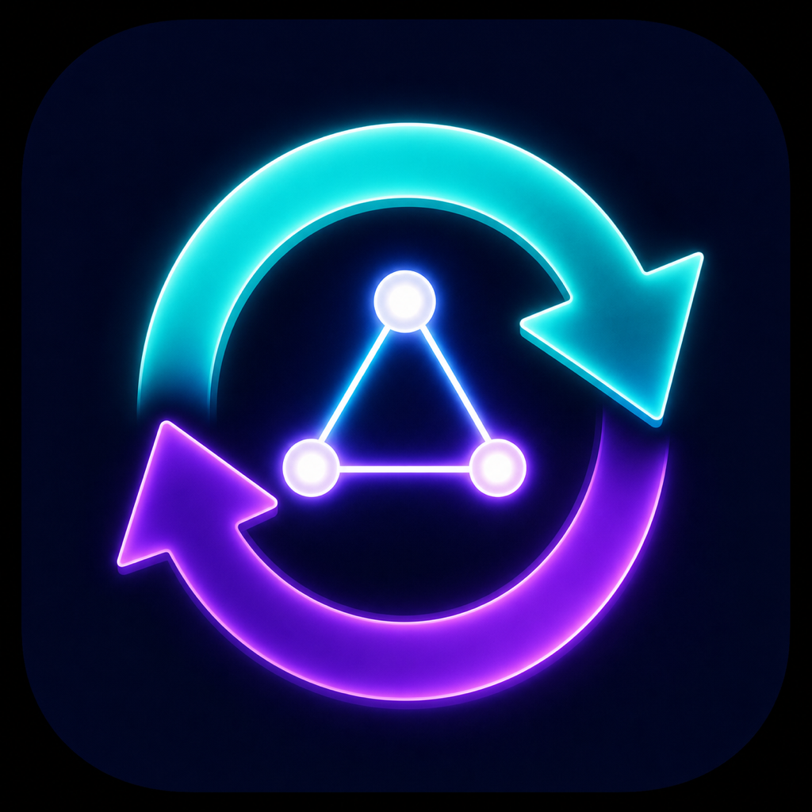

# mac-sync

<!-- markdownlint-disable MD033 -->
<p>
  
  <a href="https://github.com/stephenlclarke/mac-sync/actions/workflows/ci.yml"></a>
  <a href="https://github.com/stephenlclarke/mac-sync/actions/workflows/codeql.yml"></a>
  <a href="https://github.com/stephenlclarke/mac-sync/actions/workflows/homebrew.yml"></a>
  <a href="https://github.com/stephenlclarke/mac-sync/actions/workflows/prebuilt-binaries.yml"></a>
  <a href="https://sonarcloud.io/summary/new_code?id=stephenlclarke_mac-sync"></a>
  <a href="https://sonarcloud.io/summary/new_code?id=stephenlclarke_mac-sync"></a>
  <a href="https://sonarcloud.io/summary/new_code?id=stephenlclarke_mac-sync"></a>
  <a href="https://sonarcloud.io/summary/new_code?id=stephenlclarke_mac-sync"></a>
  <a href="https://sonarcloud.io/summary/new_code?id=stephenlclarke_mac-sync"></a>
  <a href="https://sonarcloud.io/summary/new_code?id=stephenlclarke_mac-sync"></a>
  <a href="https://sonarcloud.io/summary/new_code?id=stephenlclarke_mac-sync"></a>
  <a href="https://sonarcloud.io/summary/new_code?id=stephenlclarke_mac-sync"></a>
</p>
<br clear="left" />
<br>
<!-- markdownlint-enable MD033 -->

`mac-sync` keeps a curated snapshot of important Mac dotfiles, Homebrew
packages, VS Code extensions, encrypted secrets, and local GitHub clones in
git, split by machine name. The installed application and default CLI flow use
one private data repository, `stephenlclarke/mac-sync-data`, and do not read or
change the legacy `dot-files` repository. Explicit legacy CLI overrides remain
available for migration and compatibility work.

Snapshots are written to:

```text
~/github/mac-sync-data/machines/<machine-name>/
```

Each Mac is the golden source for its own selected files. A normal sync always
publishes those local files over that Mac's snapshot in `mac-sync-data`; the
repository never wins a timestamp-based conflict. Copying a peer snapshot into
a Mac is a separate, explicit action: missing files are added, while existing
local files are kept unless the user chooses to replace them.

The project provides both a Swift command-line engine and a native SwiftUI Mac
app with xyzzy.tools branding. Homebrew installs the CLI, the menu-bar app, and
the bundled application icon. Local source builds are for development and
release packaging only.

See [WORKFLOW.md](WORKFLOW.md) for the full download, setup, install, sync, and
restore runbook. Maintainers should use [RELEASES.md](RELEASES.md) for the
stable and current publication contract.

## Install

Install with Homebrew:

```sh
brew tap stephenlclarke/tap
brew install mac-sync
mac-sync ui
```

The opt-in Current build tracks the newest fully validated `main` commit:

```sh
brew uninstall mac-sync
brew install mac-sync-current
mac-sync ui
```

Stable and Current use separate Homebrew prefixes. Uninstall one before
switching to the other so only one Mac Sync app and CLI remain active.

The formula installs every non-system command required for syncing and encrypted
secrets: `age` (including `age-keygen`), GNU `tar` (`gtar`), Git, and a current
`rsync`. Finder launches receive those Homebrew paths automatically, and the
Homebrew service and the app-managed schedule declare the same `PATH`, so both
can find the installed tools.
Apple provides Keychain,
`gzip`, and the remaining POSIX commands on the supported macOS releases.

VS Code is an optional integration: install it separately with
`brew install --cask visual-studio-code` only if you want to sync and restore
its extension list.

On its first launch, Mac Sync finds an existing data checkout or guides you to
choose one. Select **Clone mac-sync-data Repository** only when you want the
app to clone the private data repository into a chosen empty folder. A new,
empty data repository is supported: the first sync creates and pushes the
initial snapshot. While cloning, setup shows the active destination, an
indeterminate progress bar, and an elapsed timer.

If the selected location contains a non-Git legacy folder, setup offers **Back
Up Legacy Folder and Clone…**. It moves the existing folder to a neighbouring
`.before-mac-sync` backup, clones into the original location, and restores the
original folder if the clone fails. Nothing in the legacy folder is deleted.
The default location is:

```text
~/github/mac-sync-data
```

The setup assistant stores this location in
`~/Library/Application Support/mac-sync/config.env`. That file contains paths
only—GitHub credentials continue to be managed by your existing SSH setup or
Git credential helper/Keychain. The Homebrew CLI and both scheduling options
read the same locations. Each network operation disables terminal credential
prompts. If HTTPS authentication fails and the equivalent GitHub SSH endpoint
works, Mac Sync uses that verified SSH transport for the current run. Settings
and Sync Health can verify SSH first and then change the data repository's
origin explicitly.

Use **Settings → Automatic sync** in Mac Sync to run at one or more chosen
times on specific days, choose a preset interval, or enter a custom interval from
15 minutes to 31 days. The app installs a per-user `launchd` agent using the
same local configuration as the CLI and repairs its executable and application
paths, interactive process type, and unattended environment after a Homebrew
upgrade. The agent supplies `HOME`, `USER`, a deterministic `PATH`, and
non-interactive Git settings. Unattended runs deliberately skip encrypted
secrets so a legacy Keychain ACL cannot present a password window; use **Sync
Now** or `mac-sync sync` to update them interactively. While the schedule is
enabled, Mac Sync also
opens when you sign in so its menu-bar controls remain available. Mac Sync does
not show an additional Dock icon by default; enable **Show app icon in the
Dock** under **Settings → App appearance** if you prefer regular-app behaviour.
Disabling automatic sync removes that launch-at-login registration. If you use
the app-managed schedule, stop the optional Homebrew service first so there is
only one automatic sync job:

```sh
brew services stop mac-sync-current  # or mac-sync for the stable formula
```

The Homebrew service remains available as an hourly alternative for scripted
setups:

```sh
brew services start mac-sync-current  # or mac-sync for the stable formula
brew services restart mac-sync-current
```

The desktop app and the `mac-sync run` background service are each
single-instance. Reopening Mac Sync activates the running app, while a duplicate
service launch exits successfully without starting another sync. Sync operations
are also serialised so app, scheduled, and manual runs cannot overlap.

For local development, build and launch the native app:

```sh
./script/build_and_run.sh
```

## Mac App

Mac Sync is a regular macOS app with a status item in the system menu bar. It
uses the existing CLI and the same configuration and snapshot repositories, so
there is no separate sync implementation or additional state store.

- **Overview** shows the last completed sync, live activity, warnings, errors,
  the snapshot footprint for this Mac, and the available peer snapshots. It
  distinguishes a complete sync, a usable partial sync with a skipped optional
  subsystem, and a failed sync that stopped before unsafe writes. An active
  warning or error appears in the Sync Health card instead of being repeated
  on the dashboard. While live health checks run, recorded conditions are shown
  as neutral rather than requesting remediation; recovered warnings remain
  visible as green history under Last sync health.
- **This Mac** lists the configured snapshot roots and every regular file and
  folder currently stored for the local machine. The configurable outline and
  archive browser behave like purpose-built file managers: expand or collapse
  folders, select one or more items, copy paths, reveal archived copies in
  Finder, and use the contextual actions to preview or inspect files. Both
  retain the exact selected roots in `sync-paths.txt`. A saved root can be
  removed from both the archive and Sync Selection after confirmation; the
  original source file is not deleted. Encrypted secrets are shown
  separately: a trusted recipient can use **View Encrypted Secrets** to list
  archive file and folder names. The app never displays secret values.
- **Other Macs** offers the same archive browser and lets you choose exact
  files or folders, preview their copy, then copy only those paths from the
  source snapshot in `mac-sync-data` into this Mac. The source archive is not
  changed. When a peer has encrypted secrets, trusted recipients can inspect
  its archive entries before deciding whether to restore them in Terminal. A
  manual copy always asks whether to keep this Mac's existing files or replace
  them with the selected peer snapshot.
- **Sync Selection** starts from
  `machines/<this-Mac>/config/sync-paths.txt`. Select files and folders from
  the Mac, drag or paste files from Finder, expand or collapse parent folders,
  reveal and copy selected roots, remove several at once, save it, then sync
  it. Folders are copied
  subject to that Mac's `config/excludes.txt` rules.
- **Sync History** keeps a local, per-run ledger of completed publishes and
  restores. It shows file-level uploads and downloads, whether an item was new,
  updated, removed, or skipped, and the source and destination paths. Failed
  network attempts are recorded as bounded, credential-redacted command
  diagnostics. Preview runs are deliberately not added to the history.
- **Sync Health** separates active health from history. It checks recorded
  GitHub and encrypted-secrets conditions again, automatically marks conditions
  as recovered when the underlying check passes, and retains old occurrences
  under **All**. Active conditions offer relevant actions such as testing
  GitHub, switching the data repository to verified SSH, testing encrypted
  secrets, opening Keychain Access, or retrying sync. Notes and acknowledgements
  remain local under `status/issues/` and are never synced. Automatic checks
  verify that the Keychain item exists through a metadata-only lookup without
  requesting password data or presenting authentication UI; conditions that
  require decryption stay active until the user explicitly runs **Test
  Encrypted Secrets**.
- **Automatic sync** in Settings installs a per-user `launchd` schedule. Add one
  or more day-and-time entries, including multiple times on the same day, choose
  a preset interval, or use a custom interval; Mac
  Sync keeps the schedule local, opens the app at login while the schedule is
  enabled, and never stores credentials in the launch agents. Scheduled runs
  skip encrypted secrets; use **Sync Now** when those need updating.

The menu-bar item gives quick access to the dashboard, current status, sync,
stop, refresh, About, and repository setup actions. By default the running app
stays in the menu bar without adding a Dock icon; **Settings → App appearance**
can restore the Dock icon. During an active sync, the menu-bar status icon and
the blue dashboard status icon rotate until the run finishes. The app's settings
view shows the active repository and status paths, lets you re-run local setup,
and includes a non-interactive GitHub read/write check. It never stores a GitHub
token: the check uses the Mac's existing Git authentication and redacts
credentials from its output.

## CLI Usage

```sh
mac-sync sync
mac-sync restore
mac-sync restore --select
mac-sync restore --list-machines
mac-sync restore --from old-mbp
mac-sync secrets init
mac-sync packages diff --from old-mbp
mac-sync packages install --from old-mbp
mac-sync editor diff --from old-mbp
mac-sync editor install --from old-mbp
mac-sync secrets list --from old-mbp
mac-sync secrets restore --from old-mbp
mac-sync manifest list
mac-sync ui
mac-sync version
mac-sync help restore
mac-sync help secrets
mac-sync list
mac-sync status
```

Commands:

- `sync`: copy configured home paths into the machine snapshot, commit, and push
- `run`: service mode; exits successfully if the service is already running
- `restore`: copy a machine snapshot from `mac-sync-data` back into `$HOME` and
  re-clone missing GitHub repos
- `secrets`: manage encrypted secret snapshots with `age` and Apple Keychain
- `packages`: manage Homebrew snapshots, diffs, and installs
- `editor`: manage VS Code extension snapshots, diffs, and installs
- `manifest`: show configured and dynamically discovered backup paths
- `list`: show every configured source path and repo destination
- `status`: show repo, git, local status, and last-sync state
- `ui`: open the installed Mac Sync desktop app, reusing the existing app instance when it is already running
- `version` or `--version`: show the installed Mac Sync app version and build number
- `help [topic]`: show general help or command-specific help

During `sync`, in-progress work is shown with a compact three-dot figure-eight Braille
marker from `mac-spinner`, and completed work is printed with a tick marker.
Paths that are already unchanged stay quiet.

## Documentation

The [DocC developer documentation][mac-sync-docs] covers the core
synchronisation, configuration, history, diagnostics, and scheduling APIs.

[mac-sync-docs]: https://stephenlclarke.github.io/projects/mac-sync/

Build the same static documentation locally with `make docs`.

## Development

```sh
make ci
make package-release
./script/build_and_run.sh --verify
```

CI runs Swift unit tests and the shell regression suite against coverage-instrumented
binaries, then enforces at least 85% line coverage across `MacSyncCore.swift` and
`Support.swift`. It also runs CLI smoke checks, CodeQL, SonarCloud analysis,
sanitizer jobs, Homebrew formula checks, and release publication to the Homebrew
tap. Successful exact-commit CI and CodeQL runs gate both the rolling
Current build and immutable semantic releases. The generated Sonar-compatible
report is `coverage.xml`.
SonarCloud scans all maintained source for static-analysis findings and applies
coverage only to the two instrumented core files.

### Developer ID signing

The source bundle ID is `tools.xyzzy.mac-sync`. A Developer ID Application
certificate is required for a signed, direct-distribution build; provisioning
profiles are not used for this kind of macOS signing.

Sign in to Xcode with the Apple Developer account for `stephenlclarke@mac.com`,
create or download a **Developer ID Application** certificate, and confirm that
it and its private key are in the login Keychain:

```sh
make signing-identities
```

Then build a signed archive. Substitute the identity shown by the command and,
optionally, the Apple Team ID shown in the certificate name:

```sh
make package-signed \
  MAC_SYNC_CODESIGN_IDENTITY='Developer ID Application: Stephen Clarke (TEAMID)' \
  MAC_SYNC_CODESIGN_TEAM_ID='TEAMID'
```

`make package-release` remains usable for local development without a
certificate. It never falls back to ad hoc signing when a Developer ID build is
explicitly requested. The release workflow signs archives when the repository
secrets `MAC_SYNC_DEVELOPER_ID_CERTIFICATE_P12` (base64-encoded `.p12`) and
`MAC_SYNC_DEVELOPER_ID_CERTIFICATE_PASSWORD` are configured. Certificate
material, passwords, Team IDs, and Apple credentials are not stored in this
repository.

Developer ID signing and Apple notarisation are separate steps. The current
workflow signs when configured but does not submit archives to the notarisation
service.

## Status

Show the current `mac-sync` version SHA, local repo paths, local status files,
the last completed sync, the amount of data changed by that sync, total machine
snapshot storage, warning or error messages, and the captured local Git changes
that caused a pre-operation pull to be skipped:

```sh
mac-sync status
```

Sync status is local machine state and is intentionally not committed to the
repo. By default it is written under:

```text
~/Library/Application Support/mac-sync/status/
```

Completed real syncs and restores also write one JSON record per run under
`history/<machine-name>/` in that same directory. These records contain transfer
metadata, typed health conditions, and credential-redacted command diagnostics;
they never contain decrypted secret contents. A result is `success` only when
all enabled work completed, `partial` when the usable snapshot completed but an
optional subsystem was skipped, and `failed` when the run stopped.

Use `brew services info mac-sync` for the optional Homebrew service status.
The app shows its own automatic-sync schedule in **Settings → Automatic sync**.

## Restore

Restore the current machine snapshot:

```sh
mac-sync restore
```

When the current hostname has no snapshot, restore lists available snapshots
from `~/github/mac-sync-data/machines/` and prompts for the source machine. Use
`--select` to force that prompt even when the current hostname exists:

```sh
mac-sync restore --select
```

List available restore sources:

```sh
mac-sync restore --list-machines
```

Show restore help:

```sh
mac-sync help restore
```

Restore from another machine:

```sh
mac-sync restore --from old-mbp
```

Restore pulls the data repository when its worktree is clean, then copies the
curated paths from the selected machine's
`machines/<machine-name>/config/sync-paths.txt` plus its persisted dynamic paths
from `~/github/mac-sync-data/machines/<machine-name>/dynamic-sync-paths.txt`.
It also compares the selected machine's Homebrew snapshot with the local
Homebrew and VS Code extension state and re-clones missing GitHub repositories
from the selected machine's saved clone list into `~/github`.

By default, restore copies only missing files. Existing local files in `$HOME`
remain the golden source regardless of their timestamp. Use `--force` only when
you have explicitly decided to replace existing local files and resolve
file/directory conflicts in favour of the snapshot:

```sh
mac-sync restore --from old-mbp --force
```

Preview a restore without changing local files:

```sh
MAC_SYNC_DRY_RUN=1 mac-sync restore --from old-mbp
```

In the Mac app on the destination Mac, browse the source under **Other Macs**,
select the files or folders, and choose **Copy to This Mac**. This uses the
shared `mac-sync-data` snapshot as the transfer medium and never changes the
source Mac or its archive. Before the app writes any existing local files, it
asks you to keep this Mac's copy or replace it with the selected peer snapshot.
Select **Copy specific paths only** to review the exact paths. The CLI
equivalent accepts one or more `--path` options:

```sh
mac-sync restore --from old-mbp --path .zshrc --path .config/tool
```

A selected-path restore intentionally skips Homebrew, VS Code, repository, and
encrypted-secret restore steps; use the normal restore flow when those machine
state hints are required.

When Homebrew packages differ, restore prints the manual commands needed to
install missing taps, formulae, and casks or upgrade outdated packages from the
synced list. It does not run those commands for you and it does not uninstall
extra local packages.

When VS Code extensions differ, restore prints the manual `code` commands needed
to reconcile the local extension set. It does not run those commands for you.

If an encrypted secrets snapshot exists for the selected machine, restore prints
the `mac-sync secrets list` and `mac-sync secrets restore` commands to inspect
or restore it. Normal restore never decrypts secrets automatically.

GitHub clone restore is conservative: it only uses real GitHub remotes captured
from git worktrees under the configured GitHub root, strips credentials from
stored remote URLs, and skips any target path that already exists.

## Encrypted Secrets

Install the required tools:

```sh
brew install age gnu-tar
```

Initialize this Mac's encryption identity:

```sh
mac-sync secrets init
```

Show encrypted secrets help:

```sh
mac-sync help secrets
```

That command creates an `age` identity if needed, stores the private identity in
Apple Keychain under `mac-sync age identity`, and adds only the public recipient
to the shared registry:

```text
machines/_shared/config/age-recipients.txt
```

The encrypted secret paths are listed in:

```text
machines/<machine-name>/config/secret-paths.txt
```

By default, that file includes:

```text
.ssh
.secrets
```

Once at least one recipient is configured, a normal sync writes:

```text
~/github/mac-sync-data/machines/<machine-name>/secrets/secrets.tar.gz.age
~/github/mac-sync-data/machines/<machine-name>/secrets/included-paths.txt
~/github/mac-sync-data/machines/<machine-name>/secrets/recipients.txt
```

`recipients.txt` records the public recipients used for that archive. When the shared recipient registry changes, the next sync from a Mac that can decrypt the archive re-encrypts it for the new recipient set even when the secret files have not changed. This is how a newly trusted Mac gains access without exposing any secret values.

You can also update only the encrypted secret snapshot:

```sh
mac-sync secrets sync
```

Inspect an encrypted snapshot:

```sh
mac-sync secrets list --from old-mbp
```

In the Mac app, choose a machine and select **View Encrypted Secrets** to list
the same encrypted archive's file and folder names with this Mac's Keychain
identity. That view deliberately never displays secret values or writes files.

Restore encrypted secrets:

```sh
mac-sync secrets restore --from old-mbp
```

Without `--force`, restore refuses to overwrite existing local secret files.
Use `--force` to overwrite files from the encrypted snapshot:

```sh
mac-sync secrets restore --from old-mbp --force
```

Test Keychain and current-machine archive access:

```sh
mac-sync secrets test
```

Each trusted Mac should run `mac-sync secrets init`, which adds that Mac's public
recipient to the shared registry. The Mac app offers the same action as **Set Up
This Mac's Access** when it cannot inspect an archive. It publishes only the
public recipient and never replaces an archive that this Mac cannot decrypt.
After adding a new Mac, run `mac-sync sync` once on each source Mac to re-encrypt
its current archive for the new recipient.

Before replacing an existing encrypted archive, `mac-sync` decrypts and compares
it with the new snapshot. If that verification fails, sync stops and preserves
the existing archive. A normal sync performs the Keychain recipient and archive
decryption checks before changing any managed snapshot files, so an access
failure cannot leave a partially updated data repository.

## Packages

Homebrew package state is captured during normal `mac-sync sync` when `brew` is
available. Manage it directly with:

```sh
mac-sync packages sync
mac-sync packages diff --from old-mbp
mac-sync packages install --from old-mbp
mac-sync packages install --from old-mbp --formulae-only
mac-sync packages install --from old-mbp --admin-user adm-sclarke
```

`packages diff` prints the same manual commands that `restore` prints.
`packages install` runs `brew bundle install` from the selected machine
snapshot. Use `--formulae-only` to skip casks, or `--admin-user` when cask
installs need a different admin-capable account.

## Editor State

VS Code extension state is captured during normal `mac-sync sync` when the
`code` CLI is available. Manage it directly with:

```sh
mac-sync editor sync
mac-sync editor diff --from old-mbp
mac-sync editor install --from old-mbp
```

`editor diff` prints the manual `code --install-extension` and
`code --uninstall-extension` commands. `editor install` reconciles the local VS
Code extensions to the selected machine snapshot.

## Configuration

The configured backup paths for the current Mac are listed in:

```text
machines/<machine-name>/config/sync-paths.txt
```

Paths are relative to `$HOME` unless they start with `/`. Inspect the active
manifest with:

```sh
mac-sync manifest list
mac-sync manifest configured
mac-sync manifest dynamic
mac-sync manifest source
```

At runtime, `mac-sync` also scans safe top-level dotfiles in `$HOME` and follows
safe `$HOME`, `${HOME}`, and `~` references it finds. This keeps sourced files
such as `~/.shellenv`, `~/.aliases`, `~/.functions`, and referenced plugin
directories in the sync set without hand-editing the manifest every time a
startup file changes. The generated per-machine dynamic list is persisted to:

```text
~/github/mac-sync-data/machines/<machine-name>/dynamic-sync-paths.txt
```

On later runs, paths that were previously dynamic but are no longer discovered
are pruned from that machine snapshot, unless they overlap a curated path in
the configured manifest.

Homebrew package state is captured during sync when `brew` is available. The
generated per-machine lists are persisted to:

```text
~/github/mac-sync-data/machines/<machine-name>/homebrew/
```

That directory contains sorted `taps.txt`, `formulae.txt`, and `casks.txt`
lists, plus a generated `Brewfile` for browsing or reuse.

VS Code extension state is captured during sync when `code` is available. The
generated per-machine manifest is persisted to:

```text
~/github/mac-sync-data/machines/<machine-name>/editor/vscode-extensions.txt
```

If a Homebrew or VS Code inventory command fails, sync stops without replacing
the previous package or extension snapshot with an empty result.

Git repositories under `~/github`, including nested paths such as
`xyzzy.tools/fixdecoder_rs`, are captured during sync when they have at least
one GitHub remote. The generated per-machine clone list is persisted to:

```text
~/github/mac-sync-data/machines/<machine-name>/github-repositories/repositories.txt
```

Each row stores the path relative to `~/github` and a credential-free GitHub
clone URL. Non-GitHub remotes, submodules, and non-repo directories are ignored.

Before pushing a machine snapshot, `mac-sync` checks whether the data repository
is behind its upstream branch and rebases only when needed. A configured remote
pull is attempted up to three times. Mac Sync stops before changing managed
snapshot files if it cannot verify that refresh. Unrelated local edits are
preserved with Git autostash; changes inside the current machine snapshot remain
visible as a health condition for manual review.

Rsync excludes are listed in:

```text
machines/<machine-name>/config/excludes.txt
```

Environment overrides:

- `MAC_SYNC_MACHINES_REPO`: mac-sync data repository path, defaulting to
  `~/github/mac-sync-data`
- `MAC_SYNC_REPO`: legacy-only separate command/config repository override. The
  installed app removes this override and uses `MAC_SYNC_MACHINES_REPO`.
- `MAC_SYNC_APP_CONFIG`: local app/service repository-location file, defaulting
  to `~/Library/Application Support/mac-sync/config.env`. Explicit environment
  variables take precedence over values in this file.
- `MAC_SYNC_MACHINE`: machine directory name, defaulting to the macOS host name
- `MAC_SYNC_STATUS_DIR`: local status directory, defaulting to
  `~/Library/Application Support/mac-sync/status`
- `MAC_SYNC_DRY_RUN=1`: preview sync or restore changes without writing files,
  committing, or pushing
- `MAC_SYNC_DYNAMIC_REFS=0`: disable dynamic dotfile reference discovery
- `MAC_SYNC_HOMEBREW=0`: disable Homebrew package snapshotting and restore
  command suggestions
- `MAC_SYNC_VSCODE_EXTENSIONS=0`: disable VS Code extension snapshotting and
  restore command suggestions
- `MAC_SYNC_GITHUB_ROOT`: local GitHub clone root, defaulting to `~/github`
- `MAC_SYNC_GITHUB_REPOS=0`: disable GitHub repository snapshotting and restore
  cloning
- `MAC_SYNC_SECRETS=0`: disable encrypted secret snapshotting and restore hints
- `MAC_SYNC_MANIFEST_SOURCE`: choose `config`, `auto`, or `dot-files`.
  The default `config` uses the current machine's
  `machines/<machine>/config/sync-paths.txt`. The `dot-files` option is a
  legacy compatibility mode only.
- `MAC_SYNC_KEYCHAIN_SERVICE`: Keychain service for the `age` identity,
  defaulting to `mac-sync age identity`
- `MAC_SYNC_KEYCHAIN_ACCOUNT`: Keychain account for the `age` identity,
  defaulting to `$USER` or `id -un`
- `SCRIPT_COLOUR=off`: disable colour output

## Security Notes

The regular dotfile sync list is explicit by design. Do not add raw secret
material such as SSH private keys, cloud credentials, token files, shell
history, or decrypted secret directories to
`machines/<machine-name>/config/sync-paths.txt`.
The private data repository should also ignore common credential-bearing paths
under `machines/`, but the path manifest is still the real safety boundary.

Machine names and configured or persisted paths are validated before use.
Machine names cannot be `.` or `..`, start with `-`, or contain characters
outside letters, digits, `.`, `_`, and `-`; path traversal components are
rejected.

Use encrypted secrets for `~/.ssh`, `~/.secrets`, or similar sensitive paths.
Only encrypted `*.age` snapshots and public recipients belong in git. The
private `age` identity must stay in Apple Keychain or another secret manager.

## License

This repository is licensed under the GNU Affero General Public License v3.0 or
later (AGPL-3.0-or-later). See `LICENSE`, `LICENSE.md`, and `NOTICE.md`.
