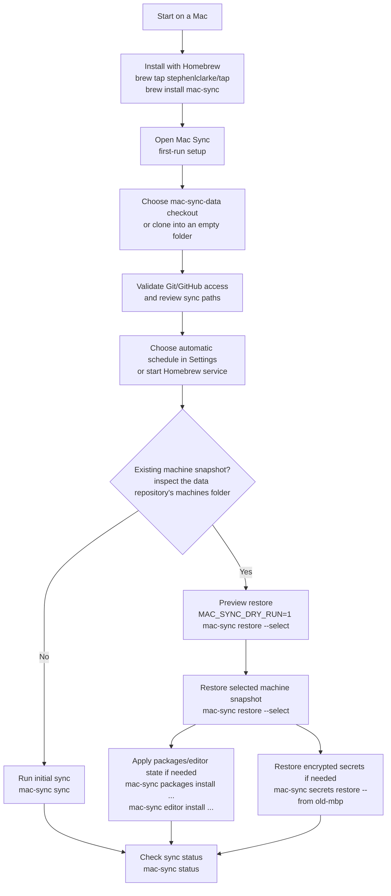
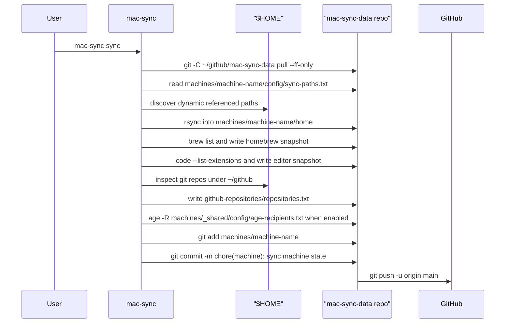
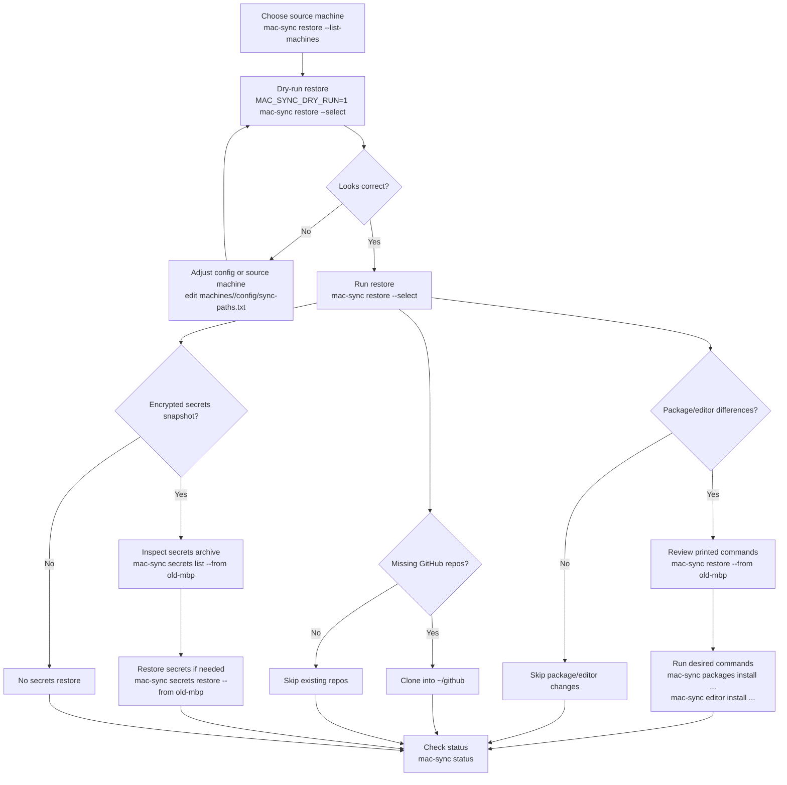
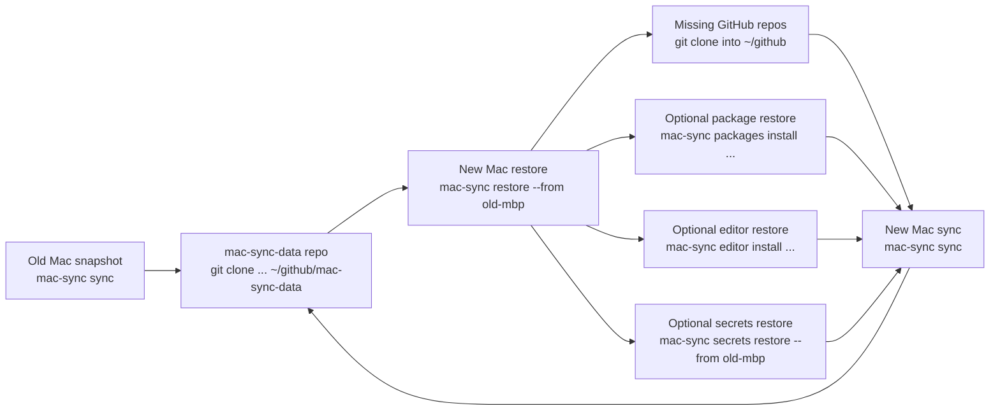

# mac-sync Workflow

<!-- markdownlint-disable MD013 -->

This workflow describes how to download, configure, install, sync, restore, and update `mac-sync` on a Mac.

Use the [README](README.md) for the quick start, the [desktop guide](docs/desktop-guide.md) for screen-by-screen help, the [CLI reference](docs/cli-reference.md) for command details, and [Configuration](docs/configuration.md) for paths and environment overrides.

> If you use desktop build 63, upgrade to a Current build containing the [menu-bar memory fix](SUPPORT.md#desktop-ui-memory-growth) before syncing with the app open. The CLI and background worker can run with the affected desktop build closed.

mac-sync is implemented as a SwiftPM package with a CLI and a native SwiftUI
macOS app. Homebrew owns the installed executables and app bundle. Automatic
sync can be controlled either by the app's per-user launchd agent or by the
optional Homebrew service. The app does not create a second sync
implementation: it runs the packaged mac-sync CLI and reads the same local
status and machine snapshot records.

`mac-sync` uses one private data repository:

- `~/github/mac-sync-data`: per-machine snapshots and configuration under
  `machines/<machine-name>/`, including dotfiles, Homebrew state, VS Code
  extension state, encrypted secrets, GitHub clone inventory, and the selected
  sync paths. The installed app and default CLI flow do not use the legacy
  `dot-files` repository; explicit legacy CLI overrides remain available only
  for migration and compatibility work.

## End-to-End Flow



## Download

Install Homebrew first if this Mac does not already have it. Then install the
released Swift binary and runtime dependencies from Homebrew:

```sh
brew tap stephenlclarke/tap
brew trust --formula stephenlclarke/tap/mac-spinner
brew install mac-sync
open "$(brew --prefix mac-sync)/MacSync.app"
```

Stable is the default `mac-sync` formula. To opt in to Current, uninstall stable before installing the other channel:

```sh
brew uninstall mac-sync
brew install mac-sync-current
```

Use `mac-sync-current` in upgrade and service commands while on that channel. Do not install both formulae together. The trust command above approves only the standalone spinner dependency, not the whole tap. See [Releases](RELEASES.md) for channel, verification and rollback details.

The formula installs the required non-system runtime commands: `age`, GNU tar (`gtar`), Git, `mac-spinner`, and rsync. Finder-launched Mac Sync adds Homebrew's standard paths
before invoking its bundled CLI, and both scheduling options declare the same
PATH. Its setup, sync, restore, and encrypted-secret flows therefore find the
installed tools in either mode. Keychain access and the other POSIX utilities
are provided by the supported macOS versions.

VS Code is optional. Install it with `brew install --cask visual-studio-code`
when you want Mac Sync to capture or apply VS Code extension snapshots.

Open Mac Sync after Homebrew installation. Its first-run assistant detects an
existing data checkout, lets you choose an alternate local folder, and clones
only when you select **Clone mac-sync-data Repository**. A new empty data
repository is valid; the first sync creates and pushes its initial snapshot.
During a clone, the assistant shows the active destination, an indeterminate
progress bar, and an elapsed timer.

If the selected location contains a non-Git legacy folder, choose **Back Up
Legacy Folder and Clone…**. After confirmation, Mac Sync moves the existing
folder to the next available `.before-mac-sync` backup path and clones into the
original location. If cloning fails, it restores the original folder when
possible and otherwise reports the exact backup location. Nothing in the legacy
folder is deleted.

The data repository defaults to:

```text
~/github/mac-sync-data
```

The app writes that location, but no credentials, to
`~/Library/Application Support/mac-sync/config.env`; the GUI, CLI, app-managed
schedule, and Homebrew service share it. Existing SSH and Keychain-backed Git
credentials are used for remote access. For scripted setup, environment
variables still take precedence:

```sh
MAC_SYNC_MACHINES_REPO=/path/to/mac-sync-data \
mac-sync status
```

## Configure

Review the tracked configuration before the first sync. The regular path list
lives with the current machine in `mac-sync-data`:

```sh
mac-sync manifest configured
```

- `machines/<machine>/config/sync-paths.txt`: regular dotfiles and directories
  to copy
- `machines/<machine>/config/excludes.txt`: `rsync` exclude patterns used
  during dotfile sync
- `machines/<machine>/config/secret-paths.txt`: sensitive paths encrypted into
  the secrets archive
- `machines/_shared/config/age-recipients.txt`: public `age` recipients trusted
  to decrypt every machine's secrets

The default machine name is derived from the macOS host name. Set
`MAC_SYNC_MACHINE` when running manual commands if you want a stable or
friendlier directory name:

```sh
MAC_SYNC_MACHINE=work-mbp mac-sync status
```

Machine names may contain letters, digits, `.`, `_`, and `-`, but cannot be
`.` or `..` or start with `-`. Configured and persisted sync paths are checked
for path traversal before they are read or written.

The machine snapshot will be written under:

```text
~/github/mac-sync-data/machines/<machine-name>/
```

## Install

Homebrew owns installation. Use the app's **Settings → Automatic sync** for a
per-user schedule, or use the Homebrew service as an hourly terminal-managed
alternative. Do not run both schedules at once:

```sh
brew tap stephenlclarke/tap
brew trust --formula stephenlclarke/tap/mac-spinner
brew install mac-sync
```

Use Homebrew for updates, restarts, and removal:

```sh
brew upgrade mac-sync
brew services restart mac-sync
brew services stop mac-sync
brew uninstall mac-sync
```

The app appears in the menu bar as Mac Sync. On first launch, it guides you
through choosing or cloning the single data repository and can test GitHub
access without prompting for or storing credentials. Use it to inspect the
local snapshot, browse peer-machine files, revise the configured file and
folder selection, start or stop sync, and preview a restore before applying it.
Sync Selection is initialised from the current machine's `config/sync-paths.txt`;
saving the selection updates that same tracked file.

When restoring from another Mac, choose **Copy specific paths only** in the
app to copy just the selected snapshot roots. This deliberately skips the
package, editor, repository, and secrets restore hints, which remain part of a
normal full restore.

For local builds and developer documentation, see [Contributing](CONTRIBUTING.md#local-development).

## Initial Sync

Run a manual sync once after installation:

```sh
mac-sync sync
```

During sync, `mac-sync`:

1. Pulls the `mac-sync-data` repository when the current machine archive is
   clean, preserving unrelated local edits in that checkout.
2. Copies configured paths from `$HOME` into the machine snapshot.
3. Discovers safe referenced dotfiles and persists dynamic paths.
4. Captures Homebrew taps, formulae, casks, and a generated `Brewfile`.
5. Captures VS Code extensions when the `code` CLI is available.
6. Captures GitHub repos below `~/github` that have GitHub remotes.
7. Updates an encrypted secrets snapshot when recipients and tools exist.
8. Commits and pushes `machines/<machine-name>` in the data repository.

Homebrew and VS Code inventories are collected before their snapshot files are
written. If either inventory command fails, sync stops and preserves the last
complete snapshot. Existing encrypted secrets are also decrypted and compared
before replacement; a decryption failure preserves the current archive and
stops sync.



Check status after the first run:

```sh
mac-sync status
```

The status output shows the `mac-sync` version SHA, data repository, last sync
result, storage totals, warnings, errors, remote repo, and commit. Explicit
legacy CLI mode reports its separate local and machines repositories. Results
are `success`, `partial` when optional work was skipped, `deferred` when a
background run waits for resources/connectivity, or `failed` when Mac Sync
stopped for another reason. Manual runs try the remote up to three times;
scheduled runs make one attempt and save a backoff. Remote refresh must pass
before managed snapshot writes begin. A failed push keeps its local commit;
the next run reconciles it with peer changes before copying new files.

## Automatic Sync

In the Mac Sync app, open **Settings → Automatic sync** and choose **Days and
time** to select any days of the week and the local time to run. The app
installs a per-user `launchd` job and uses the same local repository
configuration as the CLI. It also supports preset intervals from every 30
minutes to daily and custom intervals from 15 minutes to 31 days.

Unattended runs use public recipients to encrypt secrets without reading
Keychain identities. Inventories and encrypted archives are checked at most
daily, while regular paths follow the chosen schedule. Changed recipients
cannot replace an existing archive unattended: review the recipient list and
run **Sync Now** or `mac-sync sync` once. Explicit actions may request Keychain
access. Existing schedules with `MAC_SYNC_SECRETS=0` keep that choice; saving a
new schedule enables public-recipient encryption.

The worker uses background CPU/I/O priority and exits between runs. It waits
during Low Power Mode, serious thermal pressure or memory-pressure warnings.
Between configured paths it checks resources and a 15-minute work budget. It
does not interrupt a file copy halfway through. Retrying is idempotent through
rsync/Git; this is not an all-or-nothing filesystem transaction. The desktop UI
does not launch at login and can remain closed. Legacy app-owned worker jobs
are migrated when the worker next runs; save the schedule once to migrate it
immediately. Restart an existing Homebrew service after upgrading.
Old Cellar-pinned app jobs require that one-off schedule save before they can
run the new worker; opening the UI does not repair them or start a sync.

If you choose the app-managed schedule, stop the optional Homebrew hourly
service first so only one job runs:

```sh
brew services stop mac-sync
```

For scripted or terminal-only installations, the existing Homebrew service
remains an hourly alternative:

```sh
brew services start mac-sync
brew services restart mac-sync
brew services info mac-sync
```

The desktop app and the `mac-sync run` worker are each single-instance. Reopening the app activates the existing instance; a duplicate worker launch exits without starting another sync. Operations are serialised so app, scheduled and manual runs cannot overlap.

Both schedules run `mac-sync run`, the automation entrypoint for `sync`.
The app-managed LaunchAgent runs in the signed-in user session with explicit
`HOME`, `USER`, `PATH`, and non-interactive Git settings. Encrypted-secrets
identity reads use Security.framework rather than parsing the `security` CLI.
Local sync status is written outside git:

```text
~/Library/Application Support/mac-sync/status/<machine-name>.env
```

Each real sync or restore attempt also writes a local JSON history record
under `~/Library/Application Support/mac-sync/status/history/<machine-name>/`.
Entries stream to a local SQLite index and the JSON export, not an in-memory
array. The UI reads 50 summaries and 200 transfer entries per page. Legacy
history is streamed into the index once. Snapshot folders load 100 direct
children per page, without recursively scanning their descendants.
The SwiftUI app presents these records as uploads, downloads, new or updated
files, skipped items, typed health conditions, and redacted command diagnostics.
Preview runs and decrypted secret contents are never recorded there.

Warnings and errors from completed runs also feed local **Sync Health** under
`status/issues/`. Mac Sync checks saved conditions on open without network or
Keychain probes. Explicit tests and sync actions recheck health, remove
recovered conditions from the attention count, and retain their
occurrences under **All**. Active conditions provide direct tests and recovery
actions. Acknowledging an active item clears its Dock badge count. Notes and
triage decisions are never synced. Explicit health checks can use a metadata-only
Keychain lookup without password-return flags; a user-initiated
encrypted-secrets test performs the access and decryption checks.

Transient GitHub failures wait 15 minutes, then 30 minutes, then double to a
six-hour cap. Authentication failures wait 12 hours and remain actionable.
Retry times are checked when the schedule next fires, so a daily schedule may
retry later. HTTPS failures can fall back to verified SSH on port 22, then
`ssh.github.com:443`. This does not change `origin`, disable host-key checking
or show credential prompts. Git operations have a two-minute deadline and
low-speed limits. Conflicts are preserved for review, not force-pushed away.
A successful manual sync clears saved backoff, so automatic work can resume
after you resolve an access issue.

## Restore

Use restore when setting up a new Mac or copying a snapshot from another Mac.

Install the Homebrew package, then open Mac Sync and let the first-run assistant
choose or clone the data repository. For a terminal-only setup, clone it
manually:

```sh
brew tap stephenlclarke/tap
brew trust --formula stephenlclarke/tap/mac-spinner
brew install mac-sync
mkdir -p ~/github
git clone https://github.com/stephenlclarke/mac-sync-data ~/github/mac-sync-data
```

List available machine snapshots:

```sh
mac-sync restore --list-machines
```

If this Mac's hostname has no matching snapshot, `mac-sync restore` offers the
available machines from the `mac-sync-data` repo. If the hostname does match a
snapshot, `mac-sync restore` defaults to that snapshot; use `--select` to choose
another source interactively.

Preview a restore before writing files:

```sh
MAC_SYNC_DRY_RUN=1 mac-sync restore --select
```

Restore the selected snapshot:

```sh
mac-sync restore --select
```

Use `--force` only when the snapshot should win over newer local files:

```sh
mac-sync restore --from old-mbp --force
```

Restore copies regular dotfiles and prints Homebrew and VS Code commands when
the selected machine snapshot differs from the current Mac. It does not run
those package/editor commands for you. It also clones missing GitHub repos from
the selected machine's `github-repositories/repositories.txt` into `~/github`,
skipping targets that already exist.



## Encrypted Secrets

Initialize this Mac's Keychain-backed `age` identity:

```sh
mac-sync secrets init
```

That command stores the private identity in Apple Keychain and writes only the
public recipient to `machines/_shared/config/age-recipients.txt` in
`mac-sync-data`. New snapshots are encrypted for every recipient in that shared
registry; after adding a Mac, run `mac-sync sync` once on each source Mac to
re-encrypt its archive for the new recipient.

Update the encrypted snapshot manually:

```sh
mac-sync secrets sync
```

Inspect a source machine's encrypted archive:

```sh
mac-sync secrets list --from old-mbp
```

The Mac app provides the same safe inspection from a machine's detail view:
**View Encrypted Secrets** uses the current Mac's Keychain identity to list
archive file and folder names. It never displays decrypted secret values or
writes files.

Restore encrypted secrets:

```sh
mac-sync secrets restore --from old-mbp
```

Secrets restore refuses to overwrite existing local files unless `--force` is
used:

```sh
mac-sync secrets restore --from old-mbp --force
```

## Moving to Another Mac

For a replacement Mac, the usual order is:

1. Install the Homebrew package.
2. Open Mac Sync and use first-run setup to choose or clone `mac-sync-data`.
3. Choose an app-managed schedule or start the Homebrew service when this Mac
   is ready for scheduled syncs.
4. Run `mac-sync restore --list-machines` and pick the old Mac snapshot.
5. Run `MAC_SYNC_DRY_RUN=1 mac-sync restore --from <old-machine>`.
6. Run `mac-sync restore --from <old-machine>`.
7. Run `mac-sync packages install --from <old-machine>` if you want the old
   Homebrew state.
8. Run `mac-sync editor install --from <old-machine>` if you want the old VS
   Code extension state.
9. Run `mac-sync secrets init` to add this Mac as a trusted recipient.
10. Run `mac-sync secrets restore --from <old-machine>` if needed.
11. Re-run `mac-sync restore --from <old-machine>` if private repo cloning
    needed secrets that were restored in the previous step.
12. Run `mac-sync sync` to create this Mac's own snapshot.
13. Confirm with `mac-sync status`.



## Useful Commands

```sh
mac-sync help
mac-sync help restore
mac-sync help secrets
mac-sync list
mac-sync status
mac-sync sync
mac-sync restore --from <machine>
mac-sync packages diff --from <machine>
mac-sync packages install --from <machine>
mac-sync editor diff --from <machine>
mac-sync editor install --from <machine>
mac-sync manifest list
mac-sync secrets list --from <machine>
mac-sync secrets restore --from <machine>
brew services restart mac-sync
brew upgrade mac-sync
```

## Development and Release Validation

Build commands, coverage, sanitizers, CodeQL and quality dashboards are maintained in [Contributing](CONTRIBUTING.md#validation). Signing, exact-commit release gates, Homebrew publication, asset retention and rollback are maintained in [Releases](RELEASES.md). Process boundaries, resource limits and remaining validation gaps are described in [Architecture](docs/architecture.md).
